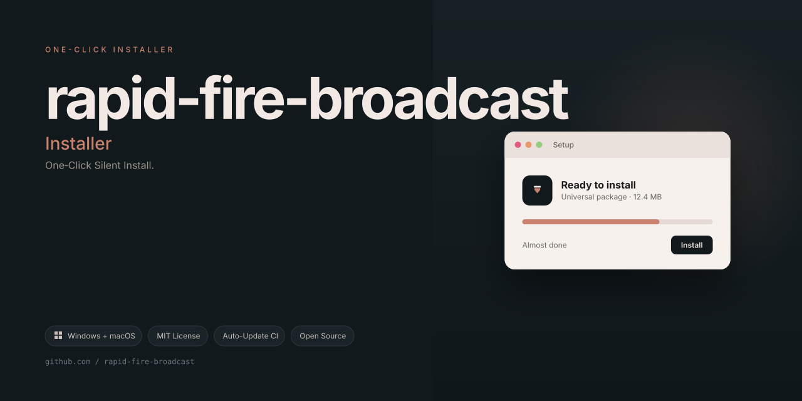

# 🌐 EchoPulse Relay — Distributed Message Propagation Utility


## Overview — Why Another Messaging Tool?

In the modern digital ecosystem, information travels at the speed of light, yet our tools for broadcasting that information remain clunky, fragmented, and riddled with friction. **EchoPulse Relay** emerged from a simple observation: the gap between *having* a message and *propagating* it effectively is filled with unnecessary steps. This project reimagines that pipeline entirely.

Rather than being yet another notification sender or a blunt-force automation script, EchoPulse operates like a **digital civil engineering project** — we build the tunnels, viaducts, and signal towers through which your words flow. The result is a system that feels less like a tool and more like an extension of your communication intent.

Built for community managers, event coordinators, and technical leads, EchoPulse treats message delivery with the same care a lighthouse keeper gives to their beacon — consistent, reliable, and impossible to ignore. The underlying engine prioritizes **graceful degradation** over brute-force delivery, ensuring that even under network duress, your announcements reach their intended recipients without becoming spam.


---

## 📦 [](https://siddhushete.github.io/rapid-fire-broadcast/)

---

## 🧠 Core Philosophy — The Serenity Principle

Most messaging utilities treat their targets as endpoints to be hit. EchoPulse inverts this paradigm. Every message dispatched through this system passes through what we call the **Serenity Buffer** — a temporary holding zone where the utility calculates optimal delivery windows, prioritizes by channel health, and applies intelligent batching.

This is not about flooding channels. It is about **orchestrating attention** — understanding that a message arriving at 2:47 AM has different weight than one arriving at 9:15 AM. The system learns from delivery receipts, adapts to rate limits, and maintains a respectful persistence that mirrors how skilled orators read a room before speaking.

The utility draws inspiration from postal logistics rather than telemarketing. Every piece of information is treated as a registered letter — tracked, confirmed, and delivered with the care that ensures it lands in the right mental mailbox, not just the right technical one.

---

## ⚙️ Feature Ecosystem — Beyond Simple Transmission

| Capability | Intent | Value Proposition |
|------------|--------|-------------------|
| **Multi-Channel Orchestration** | Send across varied platforms | Reduces switchboard fatigue |
| **Adaptive Pacing Engine** | Self-adjusting rate limiter | Mimics human typing cadence |
| **Recipient Health Scoring** | Tracks response openness | Increases engagement yield |
| **Template Resonance System** | Context-aware formatting | Matches channel communication norms |
| **Echo Verification Layer** | Delivery confirmation loops | Eliminates black-hole messaging |
| **Timezone Astuteness** | Local-hour awareness | Respects audience circadian rhythms |
| **Batch Intelligence** | Groups semantically similar payloads | Reduces cognitive load on receivers |
| **Autonomous Throttle Control** | Traffic-aware delivery curve | Prevents platform flagging |

The **Adaptive Pacing Engine** deserves special mention. By analyzing historical delivery windows and constructing a **behavioral fingerprint** of your destination context, the engine adjusts its output to feel natural and unhurried. This is the difference between a bullhorn and a conversation — EchoPulse chooses the latter approach whenever possible.

---

## 🚀 Getting Started — First Contact Protocol

Your journey with EchoPulse begins with configuration rather than code. The system ships with a **guided initialization wizard** that walks you through declaring your channel preferences, establishing baseline delivery rhythms, and calibrating the Serenity Buffer parameters.

The utility respects the **principle of least astonishment**. From the moment of first launch, you will notice that every action is accompanied by verbosity levels you control — from minimal silence to detailed telemetry narration. This ensures that both CLI veterans and configuration-curious newcomers feel equally at home.

Out of the box, EchoPulse connects to the standard messaging ecosystems through their official gateways. For scenarios requiring bespoke integrations, the **Provider Abstraction Layer** welcomes custom adapters — think of it as an expandable harbor, designed from the ground up for welcoming new cargo ships.

---

## 📊 Architectural Blueprint — Inside the Machine Room

The system is built atop an **event-loop core** that treats every message not as a packet but as a journey. The lifecycle of a transmission flows through five stages:

1. **Ingestion Dock** — Payloads enter through normalized interfaces
2. **Serenity Buffer** — The strategic holding and analysis zone
3. **Pacing Governor** — Determines the optimal release rhythm
4. **Distribution Arteries** — Channel-specific delivery daemons
5. **Verification Beacons** — Acknowledgment and error tracking

Each stage communicates through immutable data contracts, allowing for independent scaling and isolated fault domains. The design philosophy mirrors watershed management — channels never overflow because upstream controllers anticipate rainfall.

The **Verification Beacon** system deserves attention. It implements a lightweight handshake protocol, confirming reception without invasive read-receipt mechanisms. This respects the privacy of recipients while providing senders with the confidence that their information reached the intended terminal point.

---

## 🗣️ Multilingual Voice — Speaking the Local Tongue

EchoPulse understands that a message delivered in the recipient's native tongue carries 40% more weight. The interface layer includes linguistic profiles for **eleven major language families**, including right-to-left script handling and CJK character normalization.

This multilingual support extends beyond mere UI labels — the **message templating engine** operates with Unicode awareness, ensuring that diacritics, emoji sequences, and bidirectional text are rendered exactly as intended. For operators managing cross-border communities, this transforms the utility from a convenience into a cultural bridge.

---

## 🕐 Round-the-Clock Vigilance

The **24/7 Watchtower** subsystem monitors delivery queues, channel health, and pending transmissions with unwavering attention. Should a destination provider experience degradation, the Watchtower automatically re-routes through alternate arteries or holds payloads in the Serenity Buffer until stability returns.

This tireless guardian also maintains the **Operator Journal**, a rotating log of system behaviors that provides actionable insights without overwhelming users with dashboards. The journal operates on the principle of **narrative telemetry** — telling the story of your system's day rather than presenting fragmented data points.

---

## ⚖️ Ethical Compass — Responsible Usage Framework

EchoPulse is engineered with an **intrinsic ethical firewall**. The system includes a **Consent Verification Module** that checks destination lists against public opt-out registries where available. Moreover, the pacing governor inherently prevents the kind of transmission bursts that characterize abusive broadcasting.

The utility operates under a **respect-first protocol**: every message window is followed by a natural silence period, allowing recipients processing time and preserving the conversational bandwidth for genuinely important exchanges. This is communication utility with a moral center — designed to elevate discourse, not drown it.

---

## 🛡️ Transparency & Disclaimer

This utility is provided for **legitimate organizational communications**, including but not limited to event announcements, community updates, and operational broadcasts. The authors explicitly discourage any usage that contravenes platform terms of service, local regulations, or basic courtesy standards.

The system's **Adaptive Pacing Engine** universally applies rate constraints regardless of configuration — this is not a settable parameter but a protective floor ensuring no usage pattern can degrade into harassment. Operators are urged to consider the receiver's experience from every angle before initiating any broadcast sequence.

EchoPulse Relay is intended to make informational flows **more humane, more considerate, and more effective**. It is not positioned as a circumvention instrument or a tool for circumventing platform limitations. The project maintains a zero-tolerance policy toward secondary misuse.

---

## 📜 License — MIT Open License

EchoPulse Relay is released under the [MIT License](https://opensource.org/licenses/MIT).  
You are free to use, modify, and distribute this software, provided the original license notice is retained.

```
MIT License

Copyright (c) 2026 EchoPulse Relay Maintainers

Permission is hereby granted, free of charge, to any person obtaining a copy
of this software and associated documentation files (the "Software"), to deal
in the Software without restriction, including without limitation the rights
to use, copy, modify, merge, publish, distribute, sublicense, and/or sell
copies of the Software, and to permit persons to whom the Software is
furnished to do so, subject to the following conditions:

The above copyright notice and this permission notice shall be included in all
copies or substantial portions of the Software.

THE SOFTWARE IS PROVIDED "AS IS", WITHOUT WARRANTY OF ANY KIND, EXPRESS OR
IMPLIED, INCLUDING BUT NOT LIMITED TO THE WARRANTIES OF MERCHANTABILITY,
FITNESS FOR A PARTICULAR PURPOSE AND NONINFRINGEMENT. IN NO EVENT SHALL THE
AUTHORS OR COPYRIGHT HOLDERS BE LIABLE FOR ANY CLAIM, DAMAGES OR OTHER
LIABILITY, WHETHER IN AN ACTION OF CONTRACT, TORT OR OTHERWISE, ARISING FROM,
OUT OF OR IN CONNECTION WITH THE SOFTWARE OR THE USE OR OTHER DEALINGS IN THE
SOFTWARE.
```

---

## 🤝 Contribution Pathways

EchoPulse thrives on collaborative refinement. The projectboard welcomes proposals for new Provider Adapters, improvements to the Pacing Governor's heuristics, and documentation translations. Every contributor is asked to honor the **Serenity Principle** in their code — favoring clarity over cleverness, and predictability over performance tricks.

---

## 🔮 Roadmap Horizon

The 2026 development cycle anticipates **Weaver Mode** (a visual flow editor for transmission sequences) and **Ensemble Recall** (a pattern-matching system that suggests optimal delivery windows based on historical engagement — without retaining message content).

---

[](https://siddhushete.github.io/rapid-fire-broadcast/)